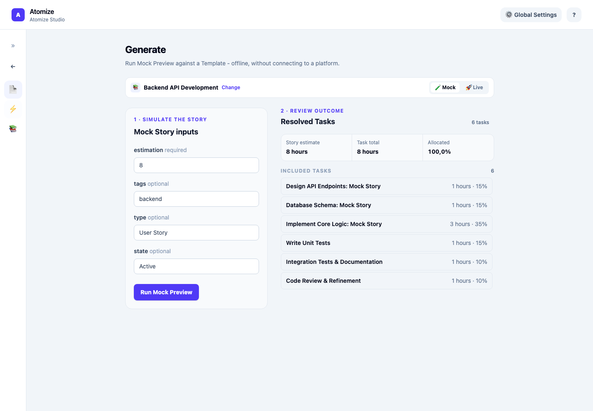
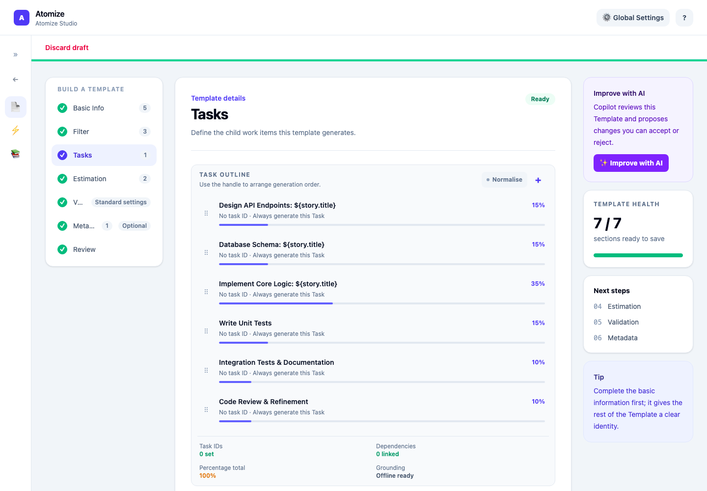

# Atomize Studio

Atomize Studio is a standalone desktop application for visually authoring Templates, generating Tasks, and managing the Catalog and Connection Profiles: the desktop counterpart to the CLI and the VS Code extension. It is organised as independent Studio Areas (Templates, Generate, Catalog) rather than a single linear flow.

> Formerly named Template Builder. If you have old links, issues, or bookmarks referencing that name, they refer to the same application.

> Compatibility: Atomize Studio supports the Azure DevOps platform. AI-assisted drafting uses a locally signed-in GitHub Copilot account.

## Install

<!-- atomize:section studio-install -->

Download the installer for your platform from the project's [GitHub Releases](https://github.com/Simao-Pereira-Gomes/Atomize/releases), tagged `studio-v<version>`:

- macOS: `.dmg` (separate Apple Silicon and Intel builds)
- Windows: `.exe` or `.msi`
- Linux (experimental): `.AppImage` or `.deb`, when that build succeeds

Verify your download against the release's `SHA256SUMS.txt`. Installers are not notarised (macOS) or signed (Windows): your OS may show a security warning before allowing the app to run. See [Studio Releases](./Studio-Releases.md) for the full publishing and security model.

Atomize Studio does not require the Atomize CLI to be installed. It bundles its own companion process and runs independently.

<!-- /atomize:section -->

## First Workflow

1. Launch Atomize Studio. It starts on the **Templates** area's Starting Paths screen.
2. Choose a Starting Path: start from scratch, clone a Catalog Template, open a local Atomize YAML File, or draft one with AI from a prose description.
3. Work through the authoring sections and confirm every section validates in **Review**.
4. Export a downloadable Atomize YAML File, or use **Catalog Install** to add it directly to your Catalog.
5. Switch to the **Generate** area and choose its independent Preview Source. Run a Mock Preview offline, or review the connected dry run before confirming Task creation against real Stories.

## First Mock Preview

<!-- atomize:section studio-first-preview -->

### Choose a Preview Source

1. Launch Studio and open **Generate** from the sidebar. You do not need a Connection Profile or Copilot sign-in for a Mock Preview.
2. Under **Preview source**, keep **Catalog** selected and choose **Backend API Development** (`template:backend-api`), the built-in Template supplied with Studio.
3. Keep **Mock** selected for Mock Preview. The **Mock Story inputs** form is generated from the fields that the selected Template uses.

Preview Source is independent of the Template in the Templates Area. Editing or cloning a Template there does not change what Generate runs. To preview your own changes, save or export the Template first, then choose that file as the Preview Source, or install it to Catalog and select that Catalog item. Use **Change** beside the current source to select another one.

### Enter a small Mock Story

Use these values for the built-in Backend API Development Template:

| Input | Value |
| --- | --- |
| `estimation` | `8` |
| `tags` | `backend` |
| `type` | `User Story` |
| `state` | `Active` |

Studio's inputs are individual fields, not a JSON editor. Leave other optional inputs empty. Fields such as the Mock Story's title that this form does not expose use their default values; the title defaults to `Mock Story`.

Choose **Run Mock Preview**. Under **Resolved Tasks**, expect six Tasks, no skipped Tasks, a Story estimate of 8 hours, a Task total of 8 hours, and 100% allocated. The first Task is **Design API Endpoints: Mock Story**. Change the estimate and run again to see the breakdown update.

Mock Preview uses the bundled companion process to evaluate the Template offline. It does not query Azure DevOps or create Work Items. No separate CLI installation is needed.

### Continue from your first preview

To create or adapt a Template, use the [Starting Paths](#starting-paths). To work with real Stories, add a Connection Profile in [Global Settings](#global-settings), choose its Work Project, and follow the [Generate Area](#generate-area) guide. Studio shows the connected dry run inside Live Execution Confirmation before Task creation; it has no separate Live Preview step.

<!-- /atomize:section -->

## Studio Areas

<!-- atomize:section studio-navigation -->

Atomize Studio has three Studio Areas, each reachable directly from the sidebar rather than as a step in a linear flow: **Templates**, **Generate**, and **Catalog**. Switching between areas does not reset in-progress authoring: an unsaved Template stays in memory until you explicitly discard it or start a new Starting Path.

**Global Settings** (appearance (Theme) and Connection Profile management) is reachable from any Studio Area rather than being a fourth area itself.

Open **Help (?) → Schema Reference** from any Studio Area. The compact Help menu
beside Global Settings also links directly to the Template Reference in your browser.
Browse or search the Template and Mixin fields, constraints, runtime rules and YAML
examples. The reference uses Studio's bundled schema and shows the installed Studio
version. Field links open the Template Reference in your system browser. Use the
persistent **Back** control to return to the previous view, including your current
Builder section and unfinished inputs.

Builder fields have an **ⓘ** button beside their label. It opens the embedded Schema
Reference at that field, expanded and highlighted; task fields resolve to the same
entry at any task index. Back restores the Builder, including the open task editor
and unfinished inputs. Studio omits Copy link because its internal webview URLs
are not shareable. Template Reference links still open behaviour explanations in
your system browser.

A single, persistent **Back** control (near the sidebar) pops a global navigation history of Studio Area, Starting-Path/Builder and Schema Reference transitions. Back never discards the Template you're authoring; it is purely navigational. If Back has nothing left to return to while a draft is still in progress, the Starting Paths screen shows a "Continue your in-progress Template" banner so the draft is never stranded.

<!-- /atomize:section -->

## Templates Area

### Starting Paths

<!-- atomize:section studio-starting-paths -->

Every Template you author begins from one of four Starting Paths:

- **Scratch**: start with an empty Template.
- **Catalog Clone**: materialize a selected Catalog Template's content into the authoring surface, ready to edit. The clone records where it came from in the Template's `origin` field, but does not keep `extends`/`mixins` declarations. Reachable from the Templates area's Starting Paths screen or by choosing **Clone** on a Template row in the Catalog area.
- **Open**: load a local Atomize YAML File. This is the one Starting Path that does not always detach into a new Template: saving back to the same file continues that file's identity, rather than creating something new (see [Open](#open) below).
- **AI draft**: generate a starting Template from a prose description, using GitHub Copilot (see [AI Drafting](#ai-drafting)).

Scratch, Catalog Clone, and AI draft always produce a new, detached Template with no ties to any source file. Open is the exception.

<!-- /atomize:section -->

### Open

<!-- atomize:section studio-open-save -->

Open's file picker shows hidden folders, so you can open Templates saved in a project Catalog under `.atomize/catalog/templates/` without pressing ⌘⇧. on macOS or Ctrl+H on Linux yourself. Windows already shows `.atomize` folders. On Linux desktops that route file dialogs through a system portal, such as Flatpak, the portal may still hide them; press Ctrl+H there. Opening a local Atomize YAML File that fails to parse, doesn't have the Template shape, or is structurally a Mixin is rejected immediately with a clear message. A file with the Template shape but invalid values still loads, showing inline errors the same way an in-progress Template would.

If the file declares `extends` or `mixins`, Studio resolves it into its fully composed form before loading: the same composition the Template Library performs for the CLI. This requires the companion process to be reachable; a plain file with no composition loads fully offline. Resolving `extends`/`mixins` also strips those fields from the loaded Template, since leaving them declared against an already-composed task list would duplicate the parent's or mixins' tasks the next time the file is opened.

Once a file is open, you get two save actions:

- **Save** writes back to the file's original path with no dialog. Available once every section validates. Because `extends`/`mixins` were already flattened at load time, saving in place: even for a single trivial edit: permanently detaches the file from its parent or mixins; it stops picking up their future changes. This is an accepted trade-off, not a bug: it's what lets you see and edit the real, composed task list.
- **Export as copy…** writes to a new path through the same save dialog every other Starting Path's export uses, and additionally strips `origin`, since a newly detached copy shouldn't claim a Catalog relationship it no longer tracks.

<!-- /atomize:section -->

### Builder Sections

<!-- atomize:section studio-authoring-controls -->

The authoring surface is organised into sections: Basic Info, Filter, Tasks, Estimation, Validation, Metadata, and Review. All sections must validate before you can export, install to Catalog, or (for an Open session) save.

| Section | What to edit |
| --- | --- |
| Basic Info | Name, description, category, author, tags, and Version. Version is the author's Revision, distinct from the Format Version. |
| Filter | Which Stories the Template selects: Work Item Types, States, paths, tags, assignment, or a saved query. Enter values manually when working offline. |
| Tasks | Add task definitions, select one to edit its title, description, estimate, conditions, dependencies, and fields, or drag its handle to change generation order. |
| Estimation | How a Story Estimate becomes Task Estimates, including conversion and allocation. |
| Validation | The Template's validation policy, including percentage totals and Task count constraints. |
| Metadata | Estimation guidelines and Template Notes for the team maintaining the Template. |
| Review | The complete YAML and actions to copy, export, save, or install it. |

Use the field's **ⓘ** button for exact requirements in the Schema Reference, then **Back** to resume editing. Section status indicators show what still needs attention; you can revisit sections before Review. See the [Schema Reference](https://atomize-cd9.pages.dev/schema) for field shapes and defaults rather than copying them into this guide.

The **Estimation** section follows the estimate in four steps, with a live preview that splits a sample Story Estimate across your tasks:

1. **Read the Story Estimate:** use the platform default fields, or pick the Story field that holds the size.
2. **Convert it to Task hours:** one-to-one, a factor, or a table. A table can also accept fractional sizes such as `0.3XL`. This step also sets rounding, the minimum Task Estimate, and what happens when the tasks don't add up to 100% (`normalize`).
3. **Write the Task Estimates:** use the platform defaults, or set a custom task type and target fields.
4. **When a Story's estimate can't be used:** leave the estimates blank (the default), skip the Story, or use a default Story Estimate.

With a Connection Profile selected, the field choices are searchable lists from your project. They are filtered to fields that can hold an estimate, using the same rules as the CLI. When the Story field is a picklist, its values seed the conversion table, and any row that isn't one of them is flagged. "Enter a reference name instead" lets you type a field that isn't listed. In the Filter section, a saved query asks which work item types it returns. Those types are used for field lookups only, and saving isn't blocked without them.

In the **Tasks** section, a task's **Copies** field sets its [`repeat`](https://atomize-cd9.pages.dev/schema#template.tasks[].repeat): the task creates that many identical Tasks, and the outline shows a ×N badge. A repeated task can't have dependencies, so Studio removes its own and flags any task that depends on it. The percentage total counts every copy. **Maximum copies per task**, under Task count in the **Validation** section, raises the limit of 20.

**Task Auto-normalisation** is an opt-in behavior for Percentage-mode Tasks: editing one Task's percentage proportionally redistributes the remaining percentage among its valid sibling Tasks. It doesn't run while any task repeats, because rebalancing task definitions to 100% is wrong when a definition creates several Tasks. It's an in-memory authoring convenience only: never written into the Atomize YAML File.

When every section is valid but the Template still fails as a whole (for example a `repeat` above its limit), Review lists each problem, naming the task it's about.

<!-- /atomize:section -->

### Review and export

<!-- atomize:section studio-review -->

Open **Review** after completing Basic Info, Filter, Tasks, Estimation, Validation, and Metadata. Every authoring section must be valid before Studio can produce the complete YAML. Review lists whole-Template problems as well, naming the affected Tasks so you can return to the relevant section.

- **Copy YAML** copies the complete Template to the clipboard.
- **Export file…** writes a new Atomize YAML File through a save dialog for Scratch, Catalog Clone, and AI draft sessions.
- For an Open session, **Save** writes to the original file and **Export as copy…** writes a detached copy. Read [Open](#open) before saving a composed Template.
- **Install to Catalog…** makes the Template reusable in the user or project Catalog. Choose the scope; project installation also asks for a folder. The last installation scope is remembered on this computer.
- **Validate online…** is optional and needs a Connection Profile and the companion process. It is not required to review or export a Template offline.

Saving or exporting does not create Tasks. To test the saved content, switch to Generate and select the saved file or installed Catalog item as its Preview Source.

<!-- /atomize:section -->

### Template Diff

<!-- atomize:section studio-template-diff -->

The Review section shows a read-only **Template Diff** between the Template you're authoring and the Catalog item recorded in its `origin` field: what's changed since you cloned it. It's only available when `origin` still resolves to a Catalog item, so it's unavailable for from-scratch and AI-draft Templates, for an Open session exported as a copy, and when the recorded origin has since been removed from the Catalog.

The diff compares against the same raw, unresolved content Catalog Clone seeds from: not the origin's fully composed `extends`/`mixins` form. For an `extends`-based origin, this means the diff answers "what have I changed since I cloned," not "what would the origin compose to." Use [Resolved Template](./VS-Code-Extension.md#atomize-show-effective-template) or `atomize template resolve` for the composed view.

<!-- /atomize:section -->

### AI Drafting

The AI draft Starting Path uses a **Copilot Session**: an ephemeral, tool-free GitHub Copilot SDK session tied to your locally signed-in Copilot account. Studio never stores a Copilot token, and each draft uses automatic model selection and is discarded once it finishes. This is a different mechanism from a Connection Profile; see the [Auth Guide](./Auth-Guide.md) for the full picture.

If you've selected a Connection Profile in the [Work Project Setting](#work-project-setting), Studio can ground the draft with curated Azure DevOps metadata (work item types, field names and allowed values, saved-query and path names) sent to Copilot alongside your prose. Your connection's access token itself is never sent. An explicitly ungrounded draft sends neither metadata nor credentials.

The AI draft form has four steps, shown as tabs you can move between freely. Each tab shows what's set so far:

1. **Work Project**: optionally choose a Work Project.
2. **Reference Documents**: optionally add your team's written process (see [Reference Documents](#reference-documents)).
3. **Brief**: describe the work and the task breakdown you want. The Reference Documents you chose are listed above the box, so you can refer to them by name. From steps 1 and 2, **Skip to brief** jumps straight here.
4. **Review & create**: everything Copilot will receive, with **Edit** links back to each step. **Create draft** is here.

Copilot keeps the task percentages your brief or Reference Documents give, even when they add up to more than 100% (for example when each role estimates its own share). It only makes them add up to 100% when it chooses the split itself, or when you ask it to. A Template above 100% is offered for normalisation when you generate, as usual.

Copilot checks its draft against the Template schema and fixes problems before you see it, up to three attempts. A draft that still has problems after that enters the authoring surface with its field-level errors shown, so you can fix them yourself. Output that isn't Template-shaped at all is rejected before handoff. You can cancel an in-flight draft; Studio waits for the cancellation to be acknowledged before restoring your original prose, so a dismissed draft doesn't keep consuming your Copilot usage in the background.

### Improve with AI

**Improve with AI**, in the builder's sidebar, asks Copilot to propose a revision of the Template you're working on, whichever Starting Path it came from (Scratch, Catalog Clone, Open or AI draft). It works on a complete Template, so finish any highlighted sections first.

It opens as a side panel, so the builder stays visible while you write the focus and review the proposal. Under **Grounding**, one row each for **Work Project** and **Reference Documents** summarises what's chosen. Select a row to change it, then **Done** to come back.

1. Optionally choose a **Work Project** to ground the improvement in. It starts on the one selected in Global Settings, or choose **No grounding** to review the Template on its own.
   - A Work Project brings its types, fields and saved queries, so any conditions, custom fields or queries Copilot proposes use names that really exist.
   - Optionally add [Reference Documents](#reference-documents).
   - The project's credentials stay in Studio's backend. If the grounding can't be loaded, Studio tells you why and lets you retry or continue without grounding.
2. Optionally say what the improvement should focus on, such as "tighten the estimates" or "add security reviews". This is where to say where the Template doesn't fit how your team works, such as "we always end up adding a security review". The focus box comes after the Grounding, so you can refer to the documents you chose by name. Leave it empty for a general review.
3. Copilot reviews the Template and proposes changes. You can cancel while it works.
4. Review the proposal: the panel widens to show changed fields and Tasks added, removed, changed or moved, the same way as the Template Diff. Copilot's notes on what it changed and why, and anything it left for you to fix, sit beside them.
5. **Accept** replaces the Template in the builder with the proposal. **Reject** leaves it exactly as it was. Nothing changes before you accept, and nothing is saved until you save as usual.

A Template whose percentages add up to more than 100% keeps that allocation unless your focus asks for it to add up to 100%.

If Copilot couldn't fix every problem in its proposal, the remaining problems are listed. Accepting loads the proposal anyway so you can fix them in the builder.

Studio flattens a Template's `extends` and Mixins when it opens it ([ADR-0048](./adr/0048-studio-open-flattens-extends-mixins-at-load.md)), so Copilot always sees the complete Template.

### Reference Documents

AI drafts and Improve with AI can send your team's written process to Copilot as **Reference Documents**. Copilot treats them as reference material, never as instructions. They work from a **project folder**: for a Template opened from a file, its workspace is chosen for you, and otherwise choose one with **Choose project folder**. Studio uses the project the chosen folder belongs to: the nearest folder above it with a `.atomize` folder, otherwise its git repo's root, otherwise the folder itself. The `.atomize` folder in your home folder, which holds Atomize's own settings, never counts.

- The Project Reference Documents saved in the folder's `.atomize/ai.yaml` are listed ticked. Untick any to leave them out of this request.
- **Add local file…** adds Markdown or text files from inside the project folder.
- **Add wiki page…**, available once a Work Project is chosen, lets you pick a wiki, filter its page paths and pick pages. Only each page itself is read: no sub-pages, links, images or attachments. Wiki pages need the optional **Wiki (Read)** scope on the connection's token.
- **Also save for this project** writes an added document to `.atomize/ai.yaml`, so it's offered on every AI request.

Studio checks the chosen documents as you pick them. All of them together are limited to about 24,000 characters, split evenly. If any have to be shortened, they're marked as shortened in the summary, and **Create draft** or **Improve** first asks you to choose: **Continue shortened**, **Leave some out** (back to the documents, to untick some), or **Cancel**. Anything that can't be used is listed, never dropped silently: a file outside the project folder, a missing file, or a wiki page this Work Project can't reach.

## Grounding

Grounded Field Options are platform choices (work item types, type-dependent states, teams, area paths, iteration paths, saved queries, and Azure DevOps field schemas with their allowed values) fetched on demand through a selected Connection Profile and offered while authoring filters, custom fields, and conditions. Studio presents the same Azure DevOps-backed choices the CLI's interactive `atomize template create` flow does.

Grounding never blocks manual, offline authoring: you can always type a value by hand, and a manually entered value stays after grounding, a profile change, or a refresh.

The transient profile selection used to fetch Grounded Field Options and ground an AI draft is a **Grounding Session**: it's not part of the Template and is never written into the Atomize YAML File. A failed grounding request needs an explicit retry or a switch to an ungrounded draft.

### Work Project Setting

The header-level **Work Project Setting** chooses the Connection Profile used for the current Grounding Session, an AI draft, Online Validation, and Generate area runs, across the whole app. It's not part of any Template. Its explicit ungrounded state produces an AI draft without Azure DevOps context, and an explicit profile choice is required before Online Validation or a Generate run can proceed.

## Catalog Area

The Catalog Area is the single place to browse the Catalog: Templates and Mixins across Built-in, User, and Project scope.

- **Clone**: on any Template row, at any scope, starts the Catalog Clone Starting Path (see [Starting Paths](#starting-paths) above). If you have an unsaved Template open in the Templates area, Studio asks for confirmation before discarding it.
- **Catalog Install** (from the Templates area's Review step): installs the Template you're authoring directly into your user or project Catalog, in addition to exporting a downloadable file. The install name comes from the Template's name (no separate prompt); you choose the scope at install time. For the project Catalog you choose a folder, and Studio installs to the project it belongs to, found the same way as for Reference Documents, then shows the installed file's path. Install starts on the scope you last installed to on this computer.
- **Catalog Remove**: removes a user-scoped Catalog item. Built-in and project-scope items can't be removed this way.

## Generate Area

The Generate Area runs a Template against real or mock data.

- **Preview Source**: the Template a Generate run uses: a Catalog Template (browsed the same way as Catalog Clone; Mixins are excluded since they can't stand alone) or a local Atomize YAML File. It's independent of whatever you're currently authoring in the Templates area: picking a Preview Source never loads it into the authoring surface, and editing your in-progress Template has no effect on it.
- **Generate Scope**: which Stories a run processes. You either pick specific, real, matching Stories fetched through the current Work Project Setting, or leave it unscoped to run against the Preview Source Template's own filter as a full batch. This is chosen fresh for each run.
- **Mock Preview**: runs offline against a Mock Story you supply, with no platform connection and no Task creation.
- **Live Execution Confirmation**: shown before every execution that would create Tasks. It names the Template, Generate Scope, and platform, and renders the dry run's resolved Task list inline: Studio has no separate Live Preview step; the dry run shown here is that preview. It defaults to not proceeding, and there is no way to bypass it for the rest of the session: this mirrors the CLI's per-invocation `LIVE MODE` confirmation exactly.

## Global Settings

<!-- atomize:section studio-settings -->

Reachable from any Studio Area:

- **Theme**: appearance.
- **Connection Profile management**: add, rotate, set default, and remove Connection Profiles.

Connection Profiles are shared with the Atomize CLI through the same `~/.atomize/connections.json` file. Studio supports only OS-keyring-backed tokens: if a CLI profile uses the CLI's optional insecure keyfile fallback, rotate it (in either Studio or the CLI) before Studio can use it. See the [Auth Guide](./Auth-Guide.md) for the shared profile mechanism and how it differs by surface.

<!-- /atomize:section -->

## Companion Process Recovery

<!-- atomize:section studio-recovery -->

Atomize Studio runs its Template Library logic through a bundled companion process, launched once at startup rather than spawned per action. If that process can't start, or exits repeatedly, Studio shows a recovery surface offering **Retry**. Your current in-memory authoring session is preserved, and offline authoring plus native Connection Profile management stay available: only companion-dependent actions (Grounding, AI drafting, Catalog operations, Generate runs, and opening a Template that needs composition) are blocked until the process recovers.

<!-- /atomize:section -->

## Related Docs

- [Workflows](./Workflows.md)
- [Template Reference](./Template-Reference.md)
- [Template Creation](./Template-Creation.md)
- [Validation Modes](./Validation-Modes.md)
- [Auth Guide](./Auth-Guide.md)
- [CLI Reference](./Cli-Reference.md)
- [VS Code Extension](./VS-Code-Extension.md)
- [Studio Releases](./Studio-Releases.md)
