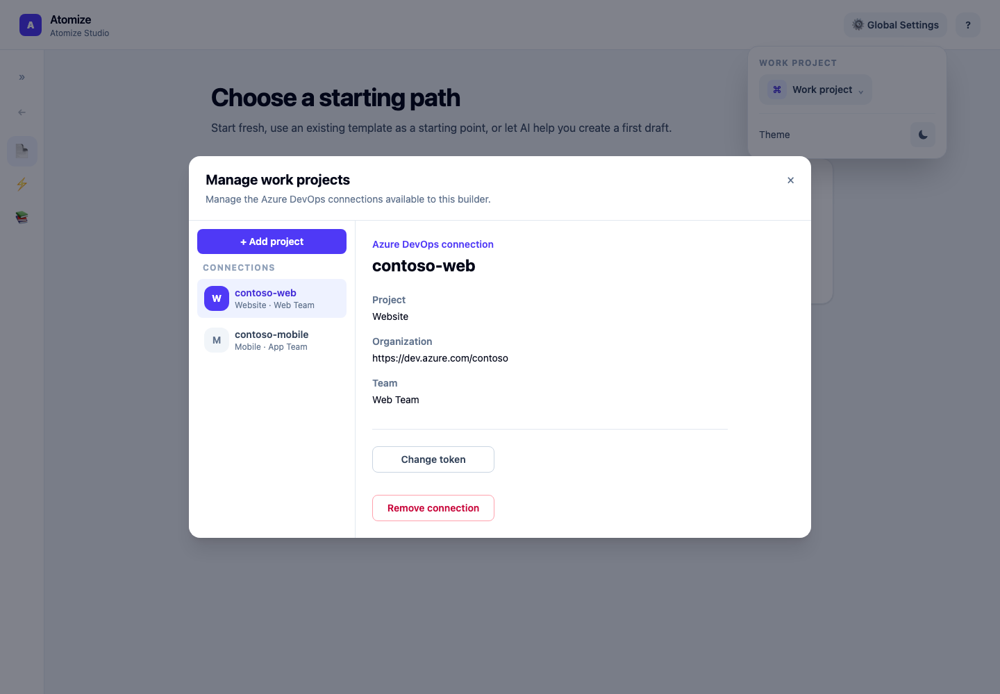
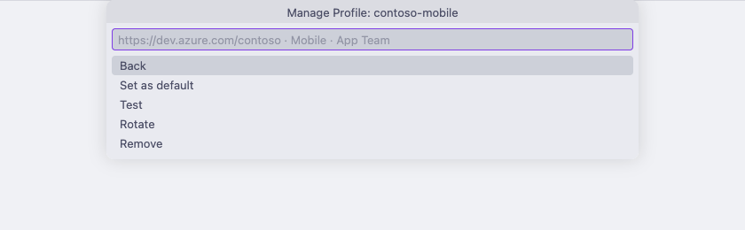

# Authentication & Connection Profiles

Atomize manages credentials as named profiles. Instead of passing a token on every command, you save a profile once and reference it by name, or rely on the default for your platform.

## Table of Contents

- [Profile Types](#profile-types)
- [Required Permissions](#required-permissions)
- [Credential Storage](#credential-storage)
- [Shared Between the CLI and Atomize Studio](#shared-between-the-cli-and-atomize-studio)
- [VS Code Profiles](#vs-code-profiles)
- [Quick Setup](#quick-setup)
- [AI Drafting: Copilot Session](#ai-drafting-copilot-session)
- [Profile Resolution Order](#profile-resolution-order)
- [Managing Multiple Profiles](#managing-multiple-profiles)
- [CI/CD Setup](#cicd-setup)
- [Rotating Tokens](#rotating-tokens)
- [Troubleshooting](#troubleshooting)

---

## Profile Types

| Type | Used for | Set up with |
|------|----------|-------------|
| **Azure DevOps** | Live Preview, Online Validation, Grounding, and Task creation | `atomize auth add`, Studio's **Manage projects…**, or VS Code's **Atomize: Manage Profiles** |

Azure DevOps is currently the only Connection Profile type. AI-assisted template drafting does not use a Connection Profile at all: see [AI Drafting: Copilot Session](#ai-drafting-copilot-session).

---

## Required Permissions

<!-- atomize:section auth-permissions -->

A Connection Profile holds an Azure DevOps organization URL, project, team, and a Personal Access Token (PAT). Create the PAT at `https://dev.azure.com/{organization}/_usersSettings/tokens` and choose the scopes your workflow needs:

| PAT scope | Access | When you need it |
|-----------|--------|------------------|
| **Work Items** | Read & write | Always. Atomize reads Stories and work item metadata, and creates Tasks. |
| **Project and Team** | Read | Grounding: project-backed field choices in Studio and grounded AI drafts and improvements in every tool. Grounding lists the project's teams and fails without this scope. |
| **Wiki** | Read | Only to use wiki pages as [Reference Documents](./Template-Creation.md#reference-documents). Without it, everything else works and Atomize tells you to rotate the token when a wiki page is needed. |

Your Azure DevOps account also needs permission to create work items in the project, for example through the Contributors group. Atomize can only do what both the token's scopes and your account allow.

Profiles keep tokens out of Templates: an Atomize YAML File never contains credentials, and the VS Code `atomize.defaultProfile` setting stores only a profile name.

<!-- /atomize:section -->

---

## Credential Storage

<!-- atomize:section auth-storage -->

The CLI stores tokens in the most secure available location, trying each tier in order:

| Tier | Storage | When used |
|------|---------|-----------|
| 1 | **OS keychain**: macOS Keychain, Windows Credential Manager, Linux secret service (libsecret) | Default when keychain is available |
| 2 | **Encrypted local file**: AES-256-GCM, stored at `~/.atomize/`, opt-in only | When keychain is unavailable and `--insecure-storage` is passed |
| 3 | **Refuse to persist** | When neither is available and `--insecure-storage` was not passed |

`auth list` shows which tier is in use for each profile: `[keychain]` or `[file]`. Atomize Studio only uses tier 1, and VS Code uses its own storage: see [Shared Between the CLI and Atomize Studio](#shared-between-the-cli-and-atomize-studio) and [VS Code Profiles](#vs-code-profiles).

### When the keychain is unavailable

Some environments do not have a working keychain: headless servers, Docker containers, and the Atomize standalone binary (`bun build --compile` cannot load native keychain bindings). In these cases:

- Interactive runs display a warning and ask whether you want to use the local file fallback.
- Non-interactive runs (CI/CD) require `--insecure-storage` to be passed explicitly to `auth add`.

```bash
echo "$AZURE_DEVOPS_PAT" | atomize auth add ci \
  --org-url https://dev.azure.com/myorg \
  --project MyProject \
  --team MyTeam \
  --default \
  --pat-stdin \
  --insecure-storage
```

In CI, prefer injecting the token from your secrets store and creating the profile inside the job workspace: see [CI/CD Setup](#cicd-setup).

<!-- /atomize:section -->

---

## Shared Between the CLI and Atomize Studio

<!-- atomize:section auth-shared -->

Connection Profiles are shared state: the CLI and Atomize Studio both read and write the same `~/.atomize/connections.json` for profile metadata and per-platform defaults, and each resolves the profile's token through its own native OS credential API against the same keychain service/account convention: there is no shared keychain implementation between the two, just a compatible convention. A profile added, removed, or made the default in one is immediately the same in the other.

Atomize Studio supports only **OS-keyring-backed** tokens (storage tier 1 above). A profile created by the CLI using the encrypted-local-file fallback (tier 2, `--insecure-storage`) is not usable from Studio until it is rotated. Rotating a profile (from either the CLI (`atomize auth rotate`) or Studio's own Connection Profile management) always stores the new token in the keyring, so a single rotation converts it to Studio-compatible storage. If Studio cannot reach the OS credential store, it cannot save or read profile tokens; offline authoring and Mock Preview still work.

Studio reads a profile's token from the keychain once per session, the first time it needs it, and keeps it in its native backend's memory (never in the app's web view). So the macOS Keychain asks for access at most once per profile per session, not on every Story search or wiki listing. Rotating or removing the profile in Studio, or Azure DevOps rejecting the token, makes Studio read it from the keychain again. A token rotated from the CLI while Studio is open is picked up when Azure DevOps rejects the old one, or when Studio restarts.

The first Azure DevOps profile you create becomes the default; later default changes are explicit.

<!-- /atomize:section -->

---

## VS Code Profiles

<!-- atomize:section auth-vscode -->

The VS Code extension keeps its own Connection Profiles, independent of the CLI and Studio. Non-secret fields live in VS Code's `globalState` and tokens in VS Code's `SecretStorage`. The extension never reads or writes `~/.atomize/connections.json` during normal use, so adding, rotating, or removing a profile in VS Code does not change the CLI or Studio, and their changes do not appear in VS Code.

If you have no VS Code profiles yet and the CLI has some, **Atomize: Manage Profiles** offers **Import from CLI...**, a one-time copy that you start yourself: choose the profiles to import, and the extension pre-fills their organization URL, project, and team from `~/.atomize/connections.json` without writing to it. Paste each access token once. Later CLI or Studio changes are not synchronized.

Connected commands ask you to choose a profile. The picker pre-selects the profile named in the `atomize.defaultProfile` setting, or the profile marked **Set as default** when the setting is blank or names an unknown profile. Set `atomize.defaultProfile` in `.vscode/settings.json` so a repository pre-selects its project; the setting stores a name, not a credential.

<!-- /atomize:section -->

---

## Quick Setup

<!-- atomize:section auth-setup -->

<a name="local-development"></a>

### Atomize CLI

```bash
# Azure DevOps profile
atomize auth add work-ado
# → prompted for org URL, project, team, and PAT
# → set as default when prompted

# Verify it works
atomize auth test work-ado
```

`atomize auth test` without a name tests the default profile. See [Required Permissions](#required-permissions) for the PAT scopes.

#### Verify your profiles

```bash
atomize auth list
```

```
  work-ado (Azure DevOps · default)
    URL:      https://dev.azure.com/myorg
    Project:  MyProject
    Team:     MyTeam
    Token:    [keychain]
    Created:  1/3/2026, 10:00:00 AM
```

Change the default with `atomize auth use <name>` and remove a profile with `atomize auth remove <name>`. AI drafting has no profile to list: it authenticates through a Copilot Session instead (see [AI Drafting: Copilot Session](#ai-drafting-copilot-session)).

### Atomize Studio

1. Open **Global Settings** from any Studio Area, open the **Work project** selector, and choose **Manage projects…** to open the connection list.
2. Choose **+ Add project** and enter a connection name, organization URL, project, team, and Personal access token. Studio saves the token in your operating system's credential store.
3. Select the connection to **Set as default**, **Change token**, or **Remove connection**. Removing a connection also deletes its stored token.
4. Choose the connection in the **Work project** selector. Studio connects and loads project details; an error marker means the connection failed. Studio has no separate test action.

<picture>
  <source media="(prefers-color-scheme: dark)" srcset="../packages/website/public/studio/connection-profiles-dark.png">
  
</picture>

Profiles you add in Studio are also available to the CLI, and the reverse: see [Shared Between the CLI and Atomize Studio](#shared-between-the-cli-and-atomize-studio).

### VS Code

1. Run **Atomize: Manage Profiles** from the Command Palette.
2. Choose **Add profile...** and enter a profile name, organization URL, project, team, and Personal Access Token. If you already use the CLI, you can choose **Import from CLI...** instead.
3. Select a profile to **Test**, **Rotate**, **Remove**, or **Set as default**. Connected commands pre-select the default profile.
4. To pre-select a different profile for a repository, set `atomize.defaultProfile` to its name in workspace settings. The setting takes precedence over the default.

<picture>
  <source media="(prefers-color-scheme: dark)" srcset="../packages/website/public/vscode/connection-profiles-dark.png">
  
</picture>

VS Code profiles are stored separately: see [VS Code Profiles](#vs-code-profiles).

<!-- /atomize:section -->

---

## AI Drafting: Copilot Session

<!-- atomize:section auth-copilot -->

`atomize template create --ai` and Atomize Studio's AI draft Starting Path both draft a Template using an ephemeral, tool-free **Copilot Session**: a GitHub Copilot SDK session running with your locally signed-in Copilot account.

- Atomize stores neither a Copilot token nor a Copilot Connection Profile. There is nothing to add, list, rotate, or remove with `atomize auth`.
- Sign-in is interactive: Atomize initiates it when needed for an interactive run. A non-interactive run (a script, a CI job) requires Copilot to already be signed in on that machine: Atomize cannot complete an interactive sign-in there.
- Each session uses automatic model selection and is discarded after the draft completes; nothing persists between drafts.
- An active GitHub Copilot subscription is required.
- The VS Code extension uses the Copilot account you are signed in to in VS Code, through VS Code's language model access. The `atomize.ai.model` setting chooses the model.

A Copilot Session is not a Connection Profile: it never appears in `atomize auth list`, has no default, and is unrelated to the Azure DevOps profile resolution below. Grounded drafts use both: Copilot writes the draft, and a Connection Profile supplies the project details.

<!-- /atomize:section -->

---

## Profile Resolution Order

<!-- atomize:section auth-resolution -->

When a CLI command needs Azure DevOps credentials, Atomize chooses a profile in this order:

1. `--profile <name>` flag on the command
2. `ATOMIZE_PROFILE` environment variable
3. Default Azure DevOps profile (set via `atomize auth use`)

If none of these names a profile, the command stops and tells you to run `atomize auth add`. `ATOMIZE_PAT` is not a fallback for connected commands: it only supplies the token when `atomize auth add` creates a profile.

This order applies to CLI commands that read Azure DevOps, such as a connected `generate`, Online Validation with `validate`, `fields list`, `queries list`, and grounded AI drafts and improvements. The Copilot Session itself does not use profile resolution: see [AI Drafting: Copilot Session](#ai-drafting-copilot-session). Studio uses its Work Project Setting, and VS Code asks you to choose a profile for each connected command.

<!-- /atomize:section -->

---

## Managing Multiple Profiles

<!-- atomize:section auth-multiple -->

You can have as many profiles as you need: one per organization, project, or environment.

```bash
# Two ADO profiles: personal and work
atomize auth add personal --org-url https://dev.azure.com/personal-org ...
atomize auth add work     --org-url https://dev.azure.com/work-org ...

# Switch between them per-run
atomize generate template:backend-api --profile personal
atomize generate template:backend-api --profile work

# Or change the default
atomize auth use work
```

### Switching the default

```bash
atomize auth use              # pick interactively
atomize auth use work-ado     # set by name
```

Azure DevOps is currently the only profile type with a default to set. Because the CLI and Studio share profile records, changing the default in either changes it in both.

### Removing a profile

```bash
atomize auth remove old-profile
atomize auth rm old-profile   # alias
```

If the removed profile was the default for its platform, Atomize prompts you to assign a new default. In scripts, pass `--confirm` to skip the confirmation and `--new-default <name>` to choose the replacement.

<!-- /atomize:section -->

---

## CI/CD Setup

<!-- atomize:section auth-ci -->

For automated environments, inject the PAT via stdin and create a short-lived profile in the job workspace.

```yaml
- name: Generate Tasks
  env:
    AZURE_DEVOPS_PAT: ${{ secrets.AZURE_DEVOPS_PAT }}
  run: |
    echo "$AZURE_DEVOPS_PAT" | atomize auth add ci \
      --org-url "${{ secrets.AZURE_DEVOPS_ORG_URL }}" \
      --project "${{ secrets.AZURE_DEVOPS_PROJECT }}" \
      --team "${{ secrets.AZURE_DEVOPS_TEAM }}" \
      --default \
      --pat-stdin \
      --insecure-storage

    atomize generate template:backend-api \
      --execute \
      --auto-approve \
      --continue-on-error
```

**Why `--pat-stdin`?** Passing the token as a flag (`--pat abc123`) risks it appearing in process listings (`ps aux`) or shell history. Reading from stdin keeps it out of both.

If your runner has a working OS keychain, you can omit `--insecure-storage`. On headless runners, the flag explicitly opts into Atomize's local encrypted file fallback for that job.

You can also provide the PAT through `ATOMIZE_PAT` while still creating a profile:

```yaml
- name: Generate Tasks
  env:
    ATOMIZE_PAT: ${{ secrets.AZURE_DEVOPS_PAT }}
  run: |
    atomize auth add ci \
      --org-url "${{ secrets.AZURE_DEVOPS_ORG_URL }}" \
      --project "${{ secrets.AZURE_DEVOPS_PROJECT }}" \
      --team "${{ secrets.AZURE_DEVOPS_TEAM }}" \
      --default \
      --insecure-storage

    atomize generate template:backend-api --execute --auto-approve
```

<!-- /atomize:section -->

---

## Rotating Tokens

<!-- atomize:section auth-rotation -->

When a PAT expires, update it in place without removing the profile:

```bash
atomize auth rotate work-ado
# → prompted for the new token
# → replaces the stored token; all other profile settings are preserved
```

For non-interactive callers, pipe the new PAT through stdin:

```bash
echo "$NEW_PAT" | atomize auth rotate work-ado --pat-stdin
```

After rotating, verify the connection:

```bash
atomize auth test work-ado
```

In Studio, open **Manage projects…**, select the connection, and choose **Change token**. The CLI and Studio share the profile, so rotating in either updates both. In VS Code, run **Atomize: Manage Profiles**, select the profile, and choose **Rotate**, then **Test**. Rotating a VS Code profile does not change the CLI or Studio profile with the same name.

<!-- /atomize:section -->

---

## Troubleshooting

<!-- atomize:section auth-troubleshooting -->

### "No default profile found"

You have not set a default profile for this platform. Either pass `--profile <name>` explicitly or run:

```bash
atomize auth use
```

### "Authentication failed: 401 Unauthorized"

- The PAT has expired: rotate it: `atomize auth rotate <name>`, **Change token** in Studio, or **Rotate** in VS Code
- The PAT does not have the required scopes (Work Items Read/Write)
- The org URL, project, or team name is wrong: remove the profile and re-add it

### Project details or grounded choices do not load

Grounding lists the project's teams, which needs the **Project and Team (Read)** PAT scope. Create a token with that scope and rotate the profile. Manual authoring, Mock Preview, and Task generation do not need it. See [Required Permissions](#required-permissions).

### "Organization URL must be an Azure DevOps host"

Use your Azure DevOps Services organization URL, such as `https://dev.azure.com/myorg` or `https://myorg.visualstudio.com`, without the project name. Azure DevOps Server (on-premises) is not supported.

### "Keychain unavailable"

The OS keychain could not be accessed. Options:
- In the CLI, re-run with `--insecure-storage` to fall back to an encrypted local file. Studio cannot use a file-stored profile.
- In CI, create a short-lived profile from your secrets store: see [CI/CD Setup](#cicd-setup)

### Studio says a profile uses CLI insecure storage

The profile was created with the CLI's `--insecure-storage` fallback. Select it in **Manage projects…** and choose **Change token**, or run `atomize auth rotate <name>` where the keychain works. Rotation moves the token to the OS credential store, where both Studio and the CLI can use it.

### Studio cannot read a profile's token

- "This Connection Profile has no token in your operating system's credential store": the keychain entry is missing. Choose **Change token** to store a new one.
- "Studio could not read this profile's token from your operating system's credential store": allow Studio's keychain access request, unlock the keychain, or on Linux make sure a secret service is running, then retry.

### VS Code says "No stored token for profile"

VS Code has the profile's fields but not its token. Run **Atomize: Manage Profiles**, remove the profile, and add it again. Tokens are not shared with the CLI or Studio, so a CLI profile with the same name does not fix it.

### "Profile not found: <name>"

The profile name does not match any saved profile. Run `atomize auth list` to see exact names. VS Code shows its own profiles in **Atomize: Manage Profiles**.

### Token visible in process list

Always use `--pat-stdin` or environment variables in CI: never pass the token as a flag argument.

### "AI drafting requires Copilot sign-in" / a non-interactive AI draft fails

Non-interactive runs (scripts, CI) need GitHub Copilot already signed in on that machine: Atomize cannot complete an interactive sign-in flow there. Sign in once interactively (e.g. `atomize template create --ai`), then re-run. See [AI Drafting: Copilot Session](#ai-drafting-copilot-session).

<!-- /atomize:section -->
