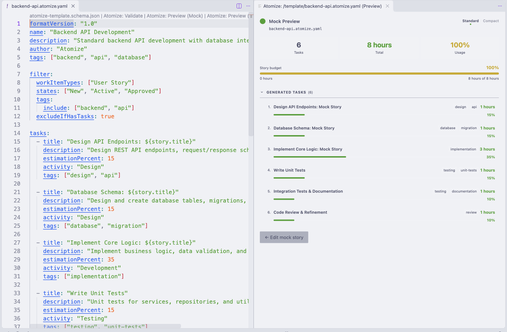
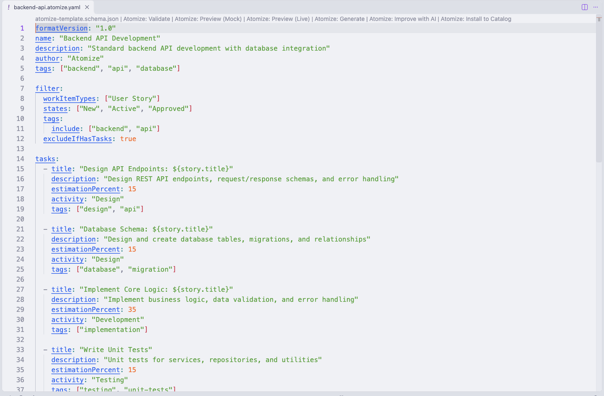
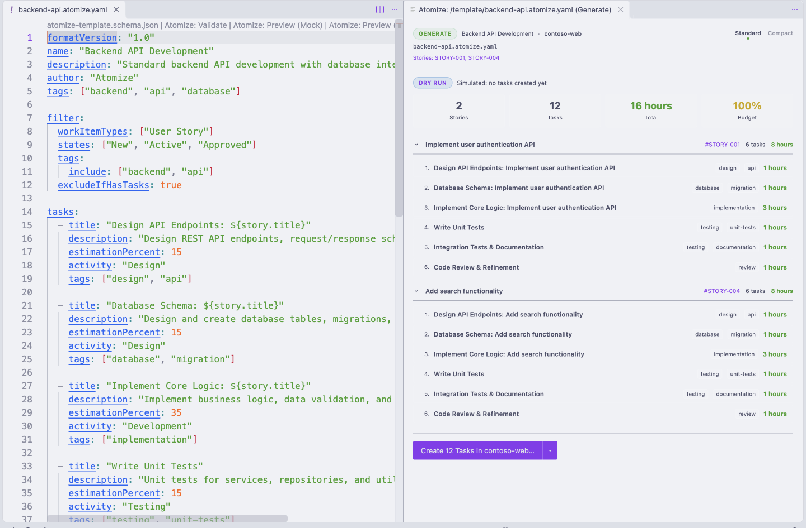
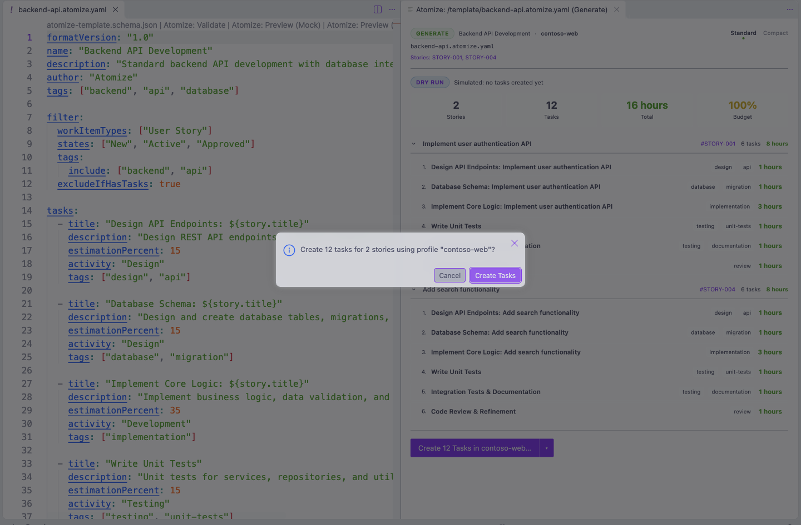

# VS Code Extension

Atomize for VS Code is the editor workflow for authoring, validating, previewing, and generating repeatable task breakdowns from Atomize YAML files.

The extension is designed for teams that want consistent task breakdowns across Stories. It runs Atomize directly in-process and keeps generation safe by previewing first: creating Tasks requires the Generate flow and an explicit confirmation.

> Compatibility: Atomize is designed around platform adapters. Today, connected generation supports Azure DevOps. Mock is available for offline testing.

> **No CLI required.** The extension embeds `@sppg2001/atomize-core` directly: it no longer spawns the Atomize CLI as a subprocess. If you're upgrading from an earlier version: the `atomize.cliPath`, `atomize.cli.installCommand`, and `atomize.cli.autoCheckUpdates` settings are deprecated no-ops. The extension shows a one-time notice if it finds any of them still set in your settings, and you can safely remove them.

## Install

<!-- atomize:section vscode-install -->

Install [Atomize (`atomize.atomize`)](https://marketplace.visualstudio.com/items?itemName=atomize.atomize) from VS Code’s Extensions view. For a packaged release, download the `.vsix` from an [extension release](https://github.com/Simao-Pereira-Gomes/Atomize/releases?q=tag%3Avscode-v0) and use **Extensions: Install from VSIX…**. No separate CLI install is needed: validation, preview, and generation all run in-process.

The extension pack includes [YAML by Red Hat](https://marketplace.visualstudio.com/items?itemName=redhat.vscode-yaml); make sure it is enabled. Atomize YAML files stay on VS Code's YAML language service so schema hovers and completions work.

<!-- /atomize:section -->

## First Workflow

1. Open or create an Atomize YAML file.
2. Run **Atomize: Validate**.
3. Run **Atomize: Preview (Mock)** to simulate a Story without platform access.
4. Run **Atomize: Manage Profiles** when connected workflows are needed.
5. Run **Atomize: Preview (Live)** to dry-run task generation against a real Story.
6. Run **Atomize: Generate** to review the plan and create Tasks after confirmation.

## First Mock Preview

<!-- atomize:section vscode-first-preview -->

### Open a built-in Template

1. Open the Command Palette with **Cmd+Shift+P** on macOS or **Ctrl+Shift+P** on Windows/Linux.
2. Run **Atomize: Browse Catalog** and find **Backend API Development** (`template:backend-api`).
3. On that row, choose the **Open backing file** button, shown as a go-to-file icon. Pressing Enter instead copies the ref, or inserts it into an active Atomize YAML File; it does not open the Template.

The built-in Template opens as a read-only Atomize YAML File. You can inspect and preview it directly. To edit your own copy, use **File: Save As…** and save it with an `.atomize.yaml` filename.

### Run Mock Preview

With the built-in Template's editor active, run **Atomize: Preview (Mock)** from the Command Palette, or select its CodeLens above the YAML. The Mock Preview Panel opens beside the editor. No Connection Profile, Azure DevOps access, or Copilot sign-in is needed.

Use these values in the generated form:

| Input | Value |
| --- | --- |
| Estimation | `8` |
| Tags | `backend` |
| Type | `User Story` |
| State | `Active` |

Select **Run Preview**. Expect six Tasks and a total Task Estimate of 8 hours, with 100% allocated. The first Task is **Design API Endpoints: Mock Story**. The form shows the fields the Template references; other Mock Story values use defaults, including the title `Mock Story`. Choose **Edit mock story** to return to the form, change the estimate, and run again to see a different allocation.

<picture>
  <source media="(prefers-color-scheme: dark)" srcset="../packages/website/public/vscode/mock-preview-dark.png">
  
</picture>

Mock Preview runs in-process, without querying a platform or creating Work Items. It uses the saved Template content. When a local file has unsaved edits, the command asks whether to save first or preview its saved version; cancel if neither is what you intend.

### Continue from your first preview

Read [Atomize YAML Opt-In](#atomize-yaml-opt-in) to enable the full authoring surface for your own files, and [Show Effective Template](#atomize-show-effective-template) to inspect composition. For connected work, set up a profile with [Manage Profiles](./Auth-Guide.md#vs-code) and the [required permissions](./Auth-Guide.md#required-permissions), then [Preview (Live)](#atomize-preview-live) before [Generate](#atomize-generate). Live Preview reads a real Story without creating Tasks; Generate requires an explicit action and confirmation before creating them.

<!-- /atomize:section -->

## Atomize YAML Opt-In

<!-- atomize:section vscode-opt-in -->

The full authoring surface is enabled for Durable Atomize YAML Opt-In files:

- `.atomize.yaml`
- `.atomize.yml`
- YAML files whose first line is `# atomize-yaml`

Durable opt-in enables CodeLens actions, save-time validation, diagnostics, snippets, and schema association.

Session Atomize YAML Opt-In provides schema-backed hovers and completions when the extension recognizes a YAML document by structure, without changing its YAML language ID or writing a marker into the file. It does not enable CodeLens or save-time Atomize validation. Prefer a durable marker for shared Templates. GitHub Actions workflow files are excluded from content detection to avoid treating their YAML as Atomize content.

For example, name a shared file `feature.atomize.yaml`, or put this modeline on the very first line of an otherwise named YAML file:

```yaml
# atomize-yaml
formatVersion: "1.0"
name: "Feature Breakdown"
```

Keep the editor language as **YAML**. The legacy `atomize-yaml` language ID is not required for schema support. A Mixin can have schema support and snippets, but cannot be run or resolved on its own; add it to a Template before previewing.

<!-- /atomize:section -->

## Authoring Support

<!-- atomize:section vscode-authoring -->

Atomize YAML authoring includes:

- schema hovers and completions
- snippets for common Template and Mixin structures (type `atm-` to list them)
- save-time diagnostics for durable Atomize YAML files
- CodeLens actions for Validate, Preview, and Generate
- quick fixes for supported validation warnings

<picture>
  <source media="(prefers-color-scheme: dark)" srcset="../packages/website/public/vscode/template-authoring-dark.png">
  
</picture>

### Snippets

| Prefix | Inserts |
|--------|---------|
| `atm-template`, `atm-mixin`, `atm-extends` | Template, Mixin and inheriting-Template scaffolds |
| `atm-task`, `atm-task-condition` | A task, or a task created only when the Story has a tag |
| `atm-task-repeat` | A task created several times as identical copies (`repeat`) |
| `atm-filter`, `atm-filter-ado`, `atm-filter-saved-query`, `atm-filter-tags` | Filter blocks. The saved-query snippet declares `workItemTypes`, which describes what the query returns and doesn't filter |
| `atm-estimation` | Strategy, rounding and `normalize` |
| `atm-estimation-factor`, `atm-estimation-table` | A Story Estimate conversion by factor (points to hours), or by table (T-shirt sizes, with optional `multipliers`) |
| `atm-estimation-target` | `taskType` and `targetFields` for customised processes |
| `atm-estimation-percent-condition` | A conditional `estimationPercent` rule |
| `atm-condition`, `atm-condition-field`, `atm-condition-number`, `atm-condition-custom` | Condition clauses on tags, built-in text fields, numbers (`estimation`, `priority`) or custom fields, each offering only the operators its field supports |
| `atm-condition-all`, `atm-condition-any` | Compound AND / OR conditions |
| `atm-validation`, `atm-custom-fields` | Validation rules and task custom fields |

### Quick Fixes

Quick fixes appear on validation warnings that have a safe automatic fix:

- **Add id field derived from task title**, for a task that has dependencies or is depended on but has no `id`
- **Remove conflicting structured filter fields**, which a `savedQuery` ignores (`workItemTypes` is kept, because it declares the query's types)
- **Strip newlines from single-line field value**
- **Rename minimumTaskPoints to minimumTaskEstimate**
- **Remove deprecated minimumTaskPoints**, when `minimumTaskEstimate` is also set

Validation runs on saved file content. If you explicitly validate a dirty document, the extension asks you to save first.

<!-- /atomize:section -->

## Commands

### Atomize: Validate

<!-- atomize:section vscode-validation -->

Validates the active Template and opens a Validation Report for explicit runs.

The picker supports:

- **Offline Validation**, which checks Template structure without a platform connection
- **Online Validation**, which uses a selected Connection Profile for checks that require platform metadata

Save-time validation is passive. It updates diagnostics without opening a panel or moving editor focus.

<!-- /atomize:section -->

### Atomize: Preview (Mock)

Runs Mock Preview against entered Story fields. It does not require a Connection Profile, does not connect to a platform, and does not create Tasks.

Use this while designing a Template or checking conditional tasks and estimation distribution.

### Atomize: Preview (Live)

<!-- atomize:section vscode-live-preview -->

Runs Live Preview against a real Story through a selected Connection Profile. It reads Story data and renders the resolved task breakdown as a dry run. It does not create Tasks.

1. Run **Atomize: Preview (Live)** from the Template's CodeLens or the Command Palette.
2. Choose a Connection Profile. The picker pre-selects your [default profile](#settings).
3. Choose one Story with the [Story Browser](#choosing-stories-the-story-browser). It opens on the current and next sprint, and you can search for any Story or type its ID. If the browser can't load Stories, you're asked for a work item ID instead.

The Live Preview Panel opens beside the editor and shows each resolved Task with its estimate. **Standard** and **Compact** switch the layout. If authentication fails, the panel explains why and offers **Manage Profiles**; a Story that can't be read shows **Work item not found** with the reason.

<!-- /atomize:section -->

### Atomize: Generate

<!-- atomize:section vscode-generate -->

Runs the Generate Panel for the active Template. The panel first shows a dry-run report. Task creation requires an explicit panel action and confirmation.

1. Run **Atomize: Generate** from the Template's CodeLens or the Command Palette.
2. Choose a Connection Profile. The picker pre-selects your [default profile](#settings), but you still choose it, and every execution is still confirmed.
3. The [Story Browser](#choosing-stories-the-story-browser) opens on the current and next sprint. Tick the Stories to generate for, or press Enter with none ticked to run on every Story the Template's filter matches. Picked Stories are handled exactly as typed Story IDs were before: the Template's `excludeIfHasTasks` still applies.
4. The Generate Panel opens beside the editor with a **DRY RUN** report: each Story with its resolved Tasks and estimates, and any Tasks skipped by conditions. Nothing has been created yet.

<picture>
  <source media="(prefers-color-scheme: dark)" srcset="../packages/website/public/vscode/generate-dry-run-dark.png">
  
</picture>

5. Choose **Create *N* Tasks in *profile*…**. The arrow beside it offers **Continue on task failure**, which keeps creating the remaining Tasks when one fails.
6. Confirm in the dialog, which names the number of Tasks and Stories and the profile, by choosing **Create Tasks**. Closing the dialog creates nothing.

<picture>
  <source media="(prefers-color-scheme: dark)" srcset="../packages/website/public/vscode/generate-confirmation-dark.png">
  
</picture>

Tasks are created only after step 6. While they're created, the panel shows how many Stories are done and how many Tasks were created; there's no cancel action once creation starts. The result shows **CREATED**, or **PARTIAL** when some Stories failed, with links to the Stories and Tasks in Azure DevOps. Tasks that were created stay in Azure DevOps even when the run fails.

The panel won't offer creation when the dry run can't support it:

- **Authentication failed**: fix the profile with **Manage Profiles**, then run Generate again.
- **No matching stories**: none of the picked Stories were found or all were excluded by `excludeIfHasTasks`, or the Template's filter matched nothing.
- **No tasks to create**: Stories matched, but the Template's conditions filtered out every Task.
- A Story that fails in the dry run blocks creation until you fix the error and run Generate again.

Use Generate only when the previewed task plan is ready to create in the connected planning system.

<!-- /atomize:section -->

### Choosing Stories: the Story Browser

<!-- atomize:section vscode-story-browser -->

Commands that need Stories use the Story Browser instead of asking you to type Story IDs. It has two modes:

- **Current and next sprint** (the default) lists Stories of your Template's Work Item types that are in your team's current or next sprint, have no Tasks yet, and aren't closed. "Closed" means any state Azure DevOps puts in the *Completed* or *Removed* category, so it works for every process. This view needs the Connection Profile's team. Type to narrow the list.
- **Search** finds any Story in the project, assigned to anyone. Type a Story ID or part of a title. The title-bar buttons narrow the results by Work Item type, state, area path and iteration (each path includes everything under it), and switch **Has Tasks** on or off. The title shows every filter in effect.

Both modes list the newest Stories first, 50 at a time. Choose **Load more…** at the end of the list for the next 50, up to 500.

The title-bar buttons switch modes, and the pencil button lets you **enter Story IDs** directly when a Story isn't listed. When several Stories can be picked, your ticks are kept while you search, change filters and load more, and IDs you enter are added to them.

<!-- /atomize:section -->

### Atomize: Manage Profiles

Opens the Profile Management Surface for Connection Profiles. From VS Code, users can add, test, rotate, remove, and set a default profile.

The extension owns its own profile storage: non-secret fields live in VS Code's `globalState`, secrets in VS Code's `SecretStorage`: independent of the CLI's `~/.atomize/connections.json`. If you already have CLI profiles, the empty state offers a one-time **Import from CLI** action that pre-fills a profile's non-secret fields from `~/.atomize/connections.json` (read-only, never written to); you re-enter the access token once. See [VS Code profiles](./Auth-Guide.md#vs-code-profiles) for details.

### Atomize: Browse Catalog

<!-- atomize:section vscode-catalog -->

Browses the Template Library Catalog. Choose a row with Enter to copy its ref, or insert it at the cursor when an Atomize YAML File is active. Use the row’s **Open backing file** button to open the item instead. Built-in Catalog items open as read-only virtual documents; user and project items open their backing files.

<!-- /atomize:section -->

<!-- atomize:section vscode-catalog-install -->

### Atomize: Install to Catalog

Installs the open Template or Mixin into a Catalog, so you can run and compose it by name, such as `atomize generate template:backend-api` or `extends: template:backend-api`. Run it from the **Atomize: Install to Catalog** CodeLens on a Template, or from the Command Palette for a Mixin.

1. If the file has unsaved changes, choose whether to save them first or install the saved version. An unsaved AI draft installs straight from the editor.
2. Choose **Personal Catalog** (`~/.atomize/catalog`, available in every folder) or **Project Catalog** (`.atomize/catalog` in the project the file belongs to: the nearest folder with a `.atomize` folder, otherwise its git repo's root). Each shows the file it would write, and Project names the project. Project comes first when the project already has its own `.atomize` folder. An unsaved draft belongs to the first open workspace folder's project. Outside any project, including your home folder, only Personal is offered.
3. A saved file installs under its own file name, and a copy goes into the Catalog while your file stays where it is. An unsaved draft installs under its Template name, and installing saves it there: its untitled tab closes without asking and the installed file opens in its place. If the name is taken, you're asked before it's overwritten.

Installing is always your choice: saving a file never adds it to a Catalog.

<!-- /atomize:section -->

<!-- atomize:section vscode-browsers -->

### Atomize: Browse Fields

Browses platform fields for a selected Connection Profile. Use this when authoring filters, custom fields, or conditions.

Choose a profile, then a work item type or **All work item types**. Pick a field to copy its reference name, such as `Microsoft.VSTS.Common.Priority`, to the clipboard.

### Atomize: Browse Queries

Browses saved platform queries for a selected Connection Profile. Pick a query to copy its path to the clipboard, ready for `filter.savedQuery.path`.

<!-- /atomize:section -->

<!-- atomize:section vscode-ai -->

### Atomize: Draft Template with AI

Drafts a new Template from a description, using the GitHub Copilot account you're signed in to in VS Code. Atomize stores no token, and the AI gets no tools: it can't read your files or reach other services. The first time, VS Code asks you to allow Atomize to use Copilot's language models.

1. Choose how to ground the draft: a Connection Profile, with your workspace default selected first, or **No project grounding**. With a profile, Atomize reads that project's work item types, states, fields and allowed values, saved queries, and area and iteration paths, and Copilot uses only those names instead of inventing its own. The profile's token is used only to read from Azure DevOps and is never sent to Copilot. If grounding can't be loaded, you choose whether to retry, continue without grounding, or cancel. If you have no profiles yet, you can add one from here.
2. Choose the **Reference Documents** to send, described below.
3. Describe the Template you need. This comes after the grounding, so you can refer to the documents you chose by name. The box's title summarises the grounding, and it's pre-filled with your last description from this session. For a longer description, use the **Open in editor** button: your text moves into an untitled Markdown prompt document, where you can write as much as you like, with the chosen documents listed at the top. When you're ready, choose **Atomize: Draft Template with AI** at the top of that document. It drafts with the grounding you already chose, without asking again.
4. Atomize writes the draft with Copilot. Copilot keeps the task percentages your brief or Reference Documents give, even when they add up to more than 100% (for example when each role estimates its own share). It only makes them add up to 100% when it chooses the split itself, or when you ask it to. A Template above 100% is offered for normalisation when you generate, as usual. Atomize checks the draft against the Template schema, and asks Copilot to fix any problems, up to three attempts. Cancel from the progress notification at any time.
5. The draft opens as a new, unsaved Atomize YAML File, with schema hovers and completions already active. Review and edit it, then save it wherever you like. Nothing is added to your Catalog unless you use **Atomize: Install to Catalog**. If problems remain after three attempts, they're listed as comments at the top of the file.

To try again, run the command again. To discard a draft, close it without saving.

This command needs GitHub Copilot Chat. If Copilot can't be used, the command tells you why and offers the fix:

- GitHub Copilot Chat isn't installed or signed in: **Install GitHub Copilot Chat**.
- You declined VS Code's permission prompt: **Try Again**.
- The model in `atomize.ai.model` isn't available: **Use Automatic** or **Open Settings**.
- The request is too large for the model: leave out some Reference Documents, run without project grounding, or choose a model with a larger limit in `atomize.ai.model`.

### Atomize: Improve Template with AI

Asks Copilot to propose a revision of the open Template, and shows it in VS Code's diff editor next to your file. Run it from the **Atomize: Improve with AI** CodeLens on a Template, or from the Command Palette. It uses the same Copilot Session as drafting, with no tools and no stored token.

1. If the file has unsaved changes, Atomize asks you to save first. It works from the saved file.
2. Choose how to ground the improvement: a Connection Profile, with your workspace default selected first, or **No grounding** to review the Template on its own.
   - With a profile, Atomize reads the project's work item types, fields and allowed values, saved queries and paths, so any conditions, custom fields or queries Copilot proposes use names that really exist.
   - The profile's token is used only to read from Azure DevOps and is never sent to Copilot. If grounding can't be loaded, you choose whether to retry, continue without grounding, or cancel.
3. Choose the **Reference Documents** to send, described below.
4. Optionally say what the improvement should focus on, such as "tighten the estimates" or "add security reviews". This is where to say where the Template doesn't fit how your team works, such as "we always end up adding a security review". It comes after the grounding, so you can refer to the documents you chose by name. The box's title summarises the grounding. Leave it blank for a general review.
5. Copilot reviews the Template. A Template whose percentages add up to more than 100% keeps that allocation unless your focus asks for it to add up to 100%. You can cancel from the progress notification.
6. The diff opens with your file on the left and Copilot's proposal on the right. Only real changes show: your comments, key order and formatting are kept wherever the content didn't change. A notification lists Copilot's notes on what it changed and why.
7. You can edit the right-hand side before deciding. Then use the buttons in the editor title bar:
   - **Accept Improvement** puts the right-hand side, including your edits, into your file as a single change you can undo. The file is left unsaved, so save it when you're happy.
   - **Save Improvement as New Template** opens the proposal as a new, unsaved Template named "*Name* (improved)", leaving your file as it was. When your file is a Catalog Template, the copy records it as its `origin`.
   - **Reject Improvement** closes the diff and leaves your file unchanged.

For a Template that uses `extends` or Mixins, Copilot sees the composed Template but never changes `extends`, Mixin references or `origin`, and never copies inherited Tasks into your file. When an inherited Task deserves a change, Copilot says so in its notes so you can change the parent or Mixin yourself. The proposal is validated composed with its parent, exactly as it will run. If Copilot can't fix every problem in its proposal, the notification lists what's left to fix.

Improving never writes to your Catalog. To add an improved copy to it, use **Atomize: Install to Catalog**.

### Reference Documents

Draft and Improve can send your team's written process to Copilot as **Reference Documents**. Copilot treats them as reference material, never as instructions. After you choose grounding, a list shows the Project Reference Documents saved in `.atomize/ai.yaml`, all ticked. Untick any to leave them out of this run, then press Enter. The title-bar buttons add more:

- **Add a local Markdown or text file**: a file dialog for `.md` and `.txt` files. They must be inside your workspace, and files reached through a link that points outside it are refused.
- **Add an Azure DevOps wiki page**: available when you chose a Connection Profile for grounding. Pick the wiki, then filter its page paths and pick the pages. Only each page itself is read: no sub-pages, links, images or attachments.

After adding documents, choose **Use for this run only** or **Also save for this project**, which adds them to `.atomize/ai.yaml` for everyone working in the repo. Editing `ai.yaml` by hand gives you completion and validation.

A saved wiki page is used only when your Connection Profile reaches that wiki's project; otherwise it's left out as unavailable for that profile. If your token can't read wikis, Atomize asks you to rotate it with the optional **Wiki (Read)** scope from Manage Profiles, and local files keep working.

All Reference Documents together are limited to about 24,000 characters, split evenly between them. If any have to be shortened, Atomize tells you before sending, and you can continue or leave some out.

<!-- /atomize:section -->

### Atomize: Show Effective Template

<!-- atomize:section vscode-effective -->

Opens the Resolved Template after applying inheritance and Mixin injections in a read-only editor beside the source. The source file is unchanged. This is useful when debugging composed Templates.

Run it with the source Template active. For an unsaved local edit, choose whether to save first or inspect the saved version. Missing parent or Mixin refs are reported as resolution errors; check the ref and Catalog item, then run the command again. A Mixin cannot be resolved as a standalone Template.

<!-- /atomize:section -->

### Atomize: Open Schema Reference

<!-- atomize:section vscode-schema -->

Opens the Schema Reference in an editor panel, labelled with the installed extension version. Browse Template and Mixin fields, search the format, and follow guide links in your external browser. The command is available from the Command Palette and the editor context menu for Atomize YAML Files. When run from an Atomize YAML File, it opens at the field under the cursor and selects the Template or Mixin tab to match the file. Comments, blank lines, and unrecognised fields open the tab at the top. Unknown nested paths fall back to the closest known field. From elsewhere it opens the Template tab at the top. Re-running the command navigates the existing panel.

You can also **Cmd-click** an Atomize YAML field name (**Ctrl-click** on Windows/Linux) to open its Schema Reference. This follows VS Code’s standard link modifier: when the multi-cursor modifier is Ctrl/Cmd, use Alt/Option-click instead. It targets the clicked field independently of your text cursor. Comments and ordinary YAML files are not linked.

Set `atomize.schemaReference.openMode` to `beside` for a wider side-by-side view, or `editor` (default) for a regular tab in the current text editor group. Changing this setting takes effect the next time you run the command, including when the reference is already open.

<!-- /atomize:section -->

### Atomize: Open Settings

Opens Atomize extension settings.

## Settings

<!-- atomize:section vscode-settings -->

| Setting | Purpose |
|---|---|
| `atomize.cliPath` | Deprecated: no longer used. The extension runs Atomize in-process and no longer spawns a CLI executable. |
| `atomize.cli.installCommand` | Deprecated: no longer used. |
| `atomize.cli.autoCheckUpdates` | Deprecated: no longer used. |
| `atomize.ai.model` | The Copilot model family to use for AI drafting, such as `gpt-4o`. Leave as `auto` (the default) to use the available Copilot model with the largest input limit, since grounded requests carry project metadata, Stories and Reference Documents. If the model you choose isn't available, Atomize offers to switch back to `auto`. |
| `atomize.defaultProfile` | Workspace-scoped profile name to preselect in Validate, Live Preview, and Generate pickers. When blank or unknown, pickers preselect the profile marked **Set as default** in **Atomize: Manage Profiles**. |
| `atomize.schemaReference.openMode` | Schema Reference layout: `beside` or `editor` (default). Applies on the next command invocation. |
| `atomize.previewLayout` | Preview panel layout: `default` or `compact`. |

The workspace default profile only preselects a Connection Profile. The user still confirms the profile before connected commands run, and explicit validation always offers Offline Validation.

VS Code’s own `editor.codeLens` setting controls whether CodeLens is visible. For YAML language-service features, `yaml.hover`, `yaml.completion`, and `yaml.validate` control hovers, completion, and YAML schema diagnostics. Atomize’s save-time Validation Diagnostics are a separate check. Use the `[yaml]` section in editor settings when you want an editor preference to apply only to YAML files.

<!-- /atomize:section -->

## Safety Model

<!-- atomize:section vscode-safety -->

Atomize previews by default.

| Surface | Connects to platform | Creates Tasks |
|---|---:|---:|
| Save-time diagnostics | No | No |
| Validate, offline | No | No |
| Validate, online | Yes | No |
| Preview (Mock) | No | No |
| Preview (Live) | Yes | No |
| Generate dry run | Yes | No |
| Generate confirmed execution | Yes | Yes |
| Draft Template with AI | No (sends your description to Copilot) | No |
| Improve Template with AI | No (sends the Template to Copilot) | No |

<!-- /atomize:section -->

## Template Example

```yaml
formatVersion: "1.0"
name: "Feature Breakdown"

filter:
  workItemTypes: ["Story"]

tasks:
  - title: "Design: ${story.title}"
    estimationPercent: 20
  - title: "Build: ${story.title}"
    estimationPercent: 60
  - title: "Validate: ${story.title}"
    estimationPercent: 20
```

For field syntax and constraints, see the [Schema Reference](https://atomize-docs.pages.dev/schema). For behaviour and worked examples, see the [Template Reference](./Template-Reference.md).

## Troubleshooting

<!-- atomize:section vscode-recovery -->

### Deprecated CLI Settings Notice

If you see a one-time notice about `atomize.cliPath`, `atomize.cli.installCommand`, or `atomize.cli.autoCheckUpdates`, it means one of those settings is still set from an earlier version of the extension. They're no-ops now (the extension runs Atomize in-process) and can be safely removed from your settings.

### Connected Commands Need A Profile

Run **Atomize: Manage Profiles** to add and test a Connection Profile. For full credential setup, see [VS Code profile setup](./Auth-Guide.md#vs-code) and [connection troubleshooting](./Auth-Guide.md#troubleshooting).

### Schema Hovers Or Completions Are Missing

Install or enable the Red Hat YAML extension, check that the document language is YAML, and check `yaml.hover` and `yaml.completion`. Prefer a Durable Atomize YAML Opt-In marker such as `.atomize.yaml`, `.atomize.yml`, or `# atomize-yaml` on the first line. If the language service is still not responding, use **Developer: Reload Window** and reopen the file.

### CodeLens Actions Are Missing

CodeLens actions are shown for Durable Atomize YAML Opt-In Templates when `editor.codeLens` is enabled. Rename the file to `.atomize.yaml` or add `# atomize-yaml` on the first line. Content detection alone does not enable CodeLens, and Mixins do not offer runnable Template actions.

### Offline Commands Cannot Complete

Save the intended Template content before retrying. The preview and Resolved Template commands use saved files, so an unsaved buffer is not automatically what they evaluate. A validation runner failure keeps existing diagnostics unchanged; those messages may describe an earlier successful validation, not the current contents. Fix the reported problem, then run Offline Validation again.

For missing Catalog or composition refs, check their names and scopes, or open the backing file to confirm it is available. A Mixin cannot be previewed independently. These offline actions do not need a Connection Profile; adding credentials does not fix malformed YAML or an unresolved local reference. If the extension is unresponsive, use **Developer: Reload Window** after saving your work.

<!-- /atomize:section -->

## Related Docs

- [Workflows](./Workflows.md)
- [Template Reference](./Template-Reference.md)
- [Template Creation](./Template-Creation.md)
- [Validation Modes](./Validation-Modes.md)
- [Auth Guide](./Auth-Guide.md)
- [CLI Reference](./Cli-Reference.md)
