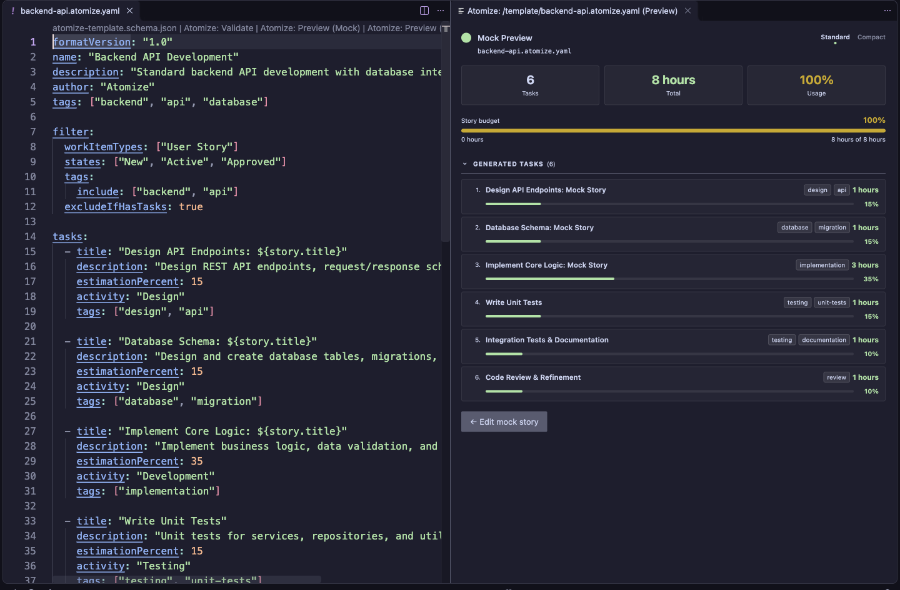
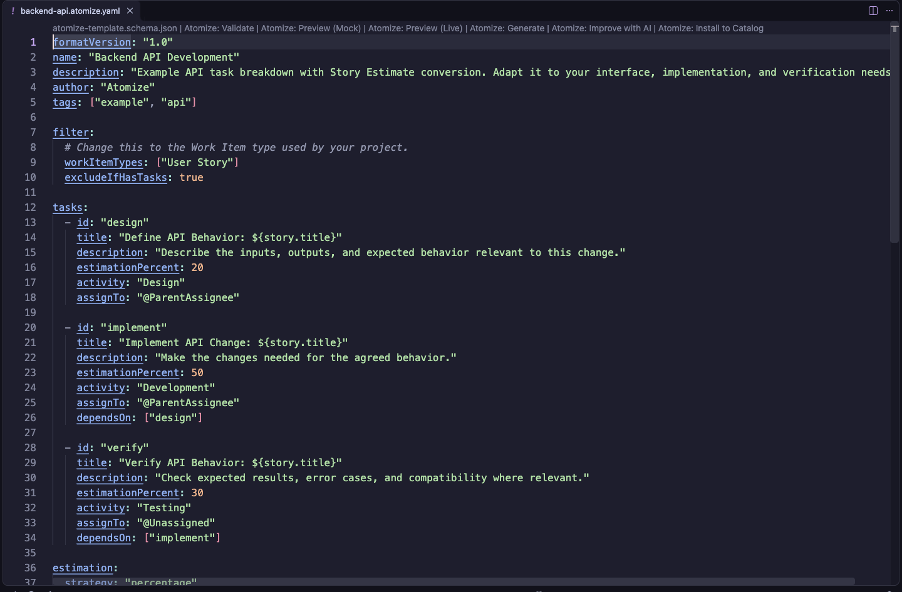
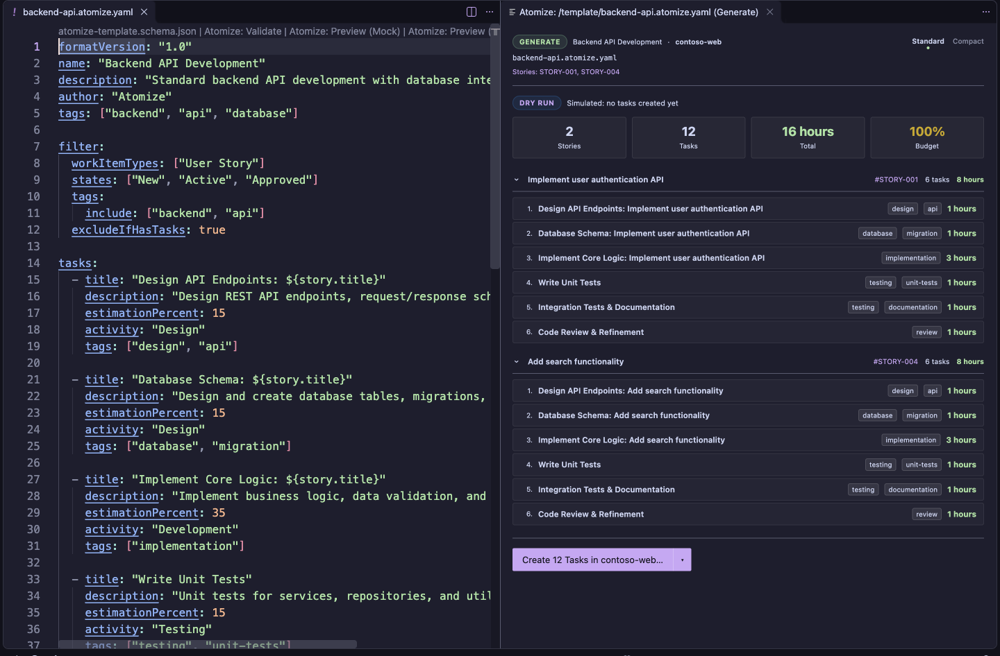
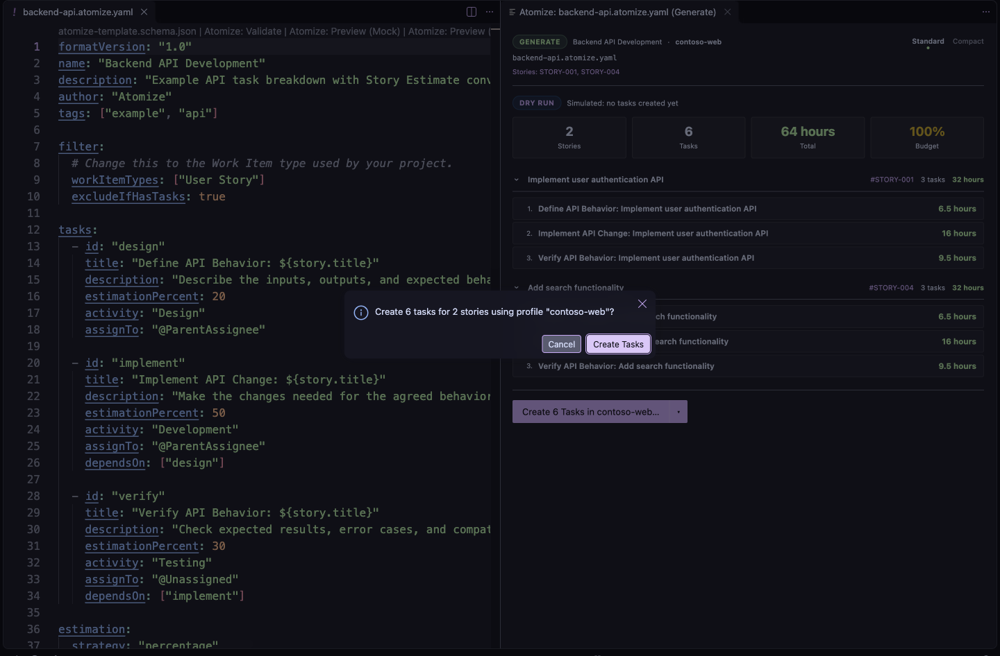
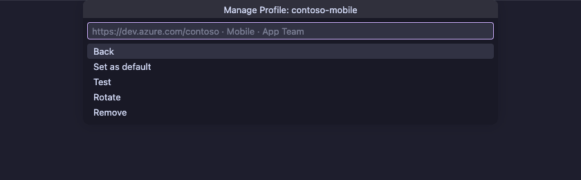

# Atomize for VS Code

Preview and generate repeatable task breakdowns from reusable YAML templates inside VS Code.

Atomize helps teams turn stories into consistent child tasks. Author Atomize YAML files with schema completions, validate them, preview the task plan, and generate tasks only after an explicit confirmation step.

Draft Templates with GitHub Copilot, review proposed improvements in a diff, and look up fields in the built-in Schema Reference without leaving the editor. No separate CLI installation is needed.

[Get started](https://atomize-docs.pages.dev/getting-started/vscode/) · [VS Code guides](https://atomize-docs.pages.dev/vscode/author-yaml/) · [Schema Reference](https://atomize-docs.pages.dev/reference/templates/schema/)

> Connected workflows support Azure DevOps. Authoring, Offline Validation, and Mock Preview work without platform credentials. AI drafting requires GitHub Copilot Chat installed and signed in.

## First Workflow

1. Run **Atomize: Browse Catalog** and open the built-in **Backend API Development** Template, or create your own `.atomize.yaml` file.
2. Run **Atomize: Validate** and choose **Offline Validation** to check the Template.
3. Run **Atomize: Preview (Mock)** to simulate Tasks without connecting to a platform. For the built-in Template, enter estimate `8`, tags `backend`, type `User Story`, and state `Active`, then select **Run Preview**.
4. Configure a Connection Profile with **Atomize: Manage Profiles** when you are ready to use connected workflows.
5. Run **Atomize: Preview (Live)** to preview against a real Story.
6. Run **Atomize: Generate** to review the plan and create Tasks only after confirmation.

Atomize previews by default. Creating Tasks requires the Generate flow and an explicit confirmation.



## Atomize YAML

Use `.atomize.yaml` or `.atomize.yml` for the full editor experience: CodeLens actions, save-time diagnostics, schema hovers, completions, and snippets.

You can also add `# atomize-yaml` on the first line of a regular YAML file. The extension may identify matching YAML content during a session, but a durable marker is recommended for team templates.

Atomize YAML files stay on VS Code's YAML language service for schema-backed hovers and completions. The extension pack installs the Red Hat YAML extension for this. Templates support inheritance, Mixins, conditional Tasks, dependencies, repeated Tasks, and estimate allocation.

```yaml
formatVersion: "1.0"
name: "Feature Breakdown"

filter:
  workItemTypes: ["Story"]

tasks:
  - title: "Design: ${story.title}"
    estimationPercent: 20
  - title: "Build: ${story.title}"
    estimationPercent: 60
  - title: "Validate: ${story.title}"
    estimationPercent: 20
```



## Commands

- **Atomize: Validate** checks the active Template and opens a Validation Report for explicit runs.
- **Atomize: Preview (Mock)** runs an offline Mock Preview from entered Story fields.
- **Atomize: Preview (Live)** runs a connected dry run against a real Story.
- **Atomize: Generate** previews the generation result, then creates Tasks only after confirmation.
- **Atomize: Manage Profiles** adds, tests, rotates, removes, and selects Connection Profiles.
- **Atomize: Browse Catalog** opens Templates and Mixins from the Template Library.
- **Atomize: Install to Catalog** installs the active Template or Mixin for reuse.
- **Atomize: Draft Template with AI** creates an unsaved Template from your description, with optional Project Grounding and Reference Documents.
- **Atomize: Improve Template with AI** proposes changes to the open Template in a diff for you to review, edit, accept, save as a new Template, or reject.
- **Atomize: Browse Fields** looks up platform fields for a selected Connection Profile.
- **Atomize: Browse Queries** looks up saved queries for a selected Connection Profile.
- **Atomize: Show Effective Template** opens the fully Resolved Template.
- **Atomize: Open Schema Reference** opens the Template and Mixin format reference with the installed extension version. Set `atomize.schemaReference.openMode` to `beside` for a wider side-by-side view or `editor` (default) for a regular editor tab. Available from the Command Palette and the editor context menu for Atomize YAML Files. It opens at the field under your cursor and selects the file’s Template or Mixin tab; outside a field, it opens that tab at the top. Running the command again navigates the existing panel. Guide links open in your browser.
- **Atomize: Open Settings** opens extension settings.

For field lookup, **Cmd-click** an Atomize YAML field name (**Ctrl-click** on Windows/Linux) to open its Schema Reference. This uses VS Code’s standard link modifier; if your multi-cursor modifier is Ctrl/Cmd, use Alt/Option-click instead. The shortcut targets the clicked field even when your text cursor is elsewhere and uses `atomize.schemaReference.openMode`.

For durable Atomize YAML files, the main file actions also appear as CodeLens commands at the top of the editor.

## Draft And Improve With AI

Use **Atomize: Draft Template with AI** to describe the breakdown you need. Choose optional Project Grounding through a Connection Profile and Reference Documents from local Markdown or text files, or Azure DevOps wiki pages. For a longer brief, select **Open in editor**. The draft opens as an unsaved Atomize YAML File for you to review and save.

Use **Atomize: Improve Template with AI** on a saved Template to request a focused change or a general review. The proposal opens beside the original in VS Code's diff editor. Edit it before choosing **Accept Improvement**, **Save Improvement as New Template**, or **Reject Improvement**. For composed Templates, Atomize preserves parent and Mixin references and reports suggested changes to inherited Tasks separately.

AI uses the GitHub Copilot account signed in to VS Code. You choose the Grounding for each run; the model receives the selected project metadata and Reference Documents, and never your Connection Profile token. Drafting and improvement do not create Tasks or install anything into your Catalog.

See [Draft and improve with AI](https://atomize-docs.pages.dev/vscode/ai/) for setup, Reference Documents, and model options.

## Validation And Preview

**Offline Validation** checks Template structure without credentials.

**Online Validation** uses a Connection Profile to verify platform-specific fields and query references. The extension always asks which profile to use before an explicit validation run. A workspace default profile may preselect an item, but it does not run connected validation silently.

**Mock Preview** does not connect to a platform and does not create Tasks.

**Live Preview** reads a real Story through a Connection Profile and shows the generated task breakdown as a dry run. It does not create Tasks.

## Generate Tasks

Run **Atomize: Generate**, choose a Connection Profile, and select Stories in the Story Browser or enter their IDs. Review the **DRY RUN** report, including each Story's planned Tasks and estimates.



Choose **Create Tasks**, then confirm the Story count, Task count, and profile in VS Code's confirmation dialog. Cancel to keep reviewing without creating anything.



Screenshots use fictional profiles and Stories and show the workflow before Task creation.

## Connection Profiles

Run **Atomize: Manage Profiles** to add, test, rotate, remove, or set a default Connection Profile.

The extension owns profile storage: non-secret fields (name, organization URL, project, team) live in VS Code's extension state and tokens live in VS Code Secret Storage. Profiles are stored separately from the Atomize CLI.

The profile marked **Set as default** is preselected in connected workflows unless `atomize.defaultProfile` names another existing profile for the workspace. You still confirm the profile before each run.



If you used the Atomize CLI before adopting the extension, the profile picker's empty state offers a one-time **Import from CLI** action that pre-fills the Add Profile form from `~/.atomize/connections.json` (read-only, never written to). You re-enter each token once during import.

Use **Atomize: Browse Fields** and **Atomize: Browse Queries** to copy exact field reference names and saved query paths from the selected project into your Template.

For credential scopes and setup, see [Connect Azure DevOps](https://atomize-docs.pages.dev/connections/) and [Connection Profiles](https://atomize-docs.pages.dev/connections/profiles/#vs-code).

## Settings

- `atomize.defaultProfile`: workspace-scoped profile name to preselect in the Validate, Live Preview, and Generate pickers.
- `atomize.ai.model`: Copilot model family for drafting and improvement; `auto` selects the available model with the largest input limit.
- `atomize.schemaReference.openMode`: `beside` or `editor` (default); applies when you next open the Schema Reference.
- `atomize.previewLayout`: preview panel layout, either `default` or `compact`.

> Upgrading from an earlier version? The `atomize.cliPath`, `atomize.cli.installCommand`, and `atomize.cli.autoCheckUpdates` settings are deprecated no-ops. The extension shows a one-time notice if any are still set, and you can safely remove them.

## Documentation

- [Documentation portal](https://atomize-docs.pages.dev/)
- [VS Code quickstart](https://atomize-docs.pages.dev/getting-started/vscode/)
- [Author and validate YAML](https://atomize-docs.pages.dev/vscode/author-yaml/)
- [Draft and improve with AI](https://atomize-docs.pages.dev/vscode/ai/)
- [Inspect Templates and the Schema Reference](https://atomize-docs.pages.dev/vscode/inspect-templates/)
- [Generate Tasks](https://atomize-docs.pages.dev/vscode/generate/)
- [Workflows](https://atomize-docs.pages.dev/workflows/)
- [Template structure](https://atomize-docs.pages.dev/reference/templates/)
- [Validation and troubleshooting](https://atomize-docs.pages.dev/validation/)
